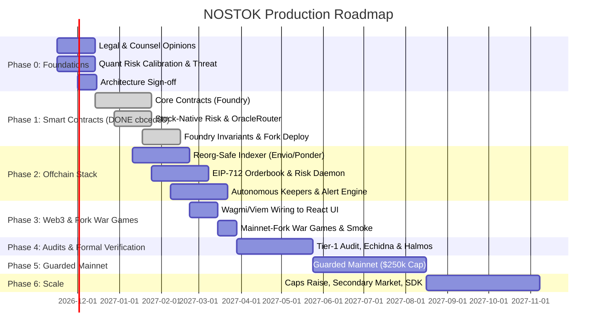

# NOSTOK Production Engineering Roadmap & Delivery Blueprint

**Project:** NOSTOK — Fixed-Term Peer-to-Peer Repo Market for Tokenized Stocks on Base  
**Target Chain:** Base Mainnet (Chain ID 8453) | Pre-production: Base Mainnet Fork (`anvil --fork-url`) + Guarded Mainnet Launch (low caps, allowlist, pause available, raise caps slowly)  
**Status:** Phase 1 Smart Contracts Complete at commit `cbced00` (84 Foundry tests, 4 stateful invariant tests, fork deploy OK)  
**Component Status:**
- **Completed (`cbced00`):** Core Smart Contracts (`CollateralEscrow`, `PositionNFT`, `LoanCore`, `OrderSettlement`, `LiquidationAuction`, `OracleRouter`, `AssetRegistry`, `EligibilityGate`, `FeeCollector`, `NostokTimelock`), Deployment Script (`DeployNostok.s.sol`), 84 Foundry unit/integration/fork tests & 4 stateful invariant tests, and React 18 + Vite UI presentation layer (`nostok/src`).
- **Not Built Yet:** Keeper for `syncMultiplier`, frontend Web3 wiring, indexer/backend services, Euler yield integration, pull-based collateral claim queue (deferred), secondary DEX TWAP/`DISPUTED` check (deferred to audit phase), Echidna 1M-run campaign & Halmos/Certora proofs (moved to Phase 4 audit phase).

---

## 1. Executive Summary & Strategic Context

NOSTOK delivers an institutional-grade, fixed-rate, peer-to-peer repurchase (repo) market on Base. Borrowers escrow tokenized equities (Coinbase B20 tokens such as NVDAc, AAPLc, MSFTc) to borrow USDC at deterministic terms. Lenders receive transferable ERC-721 Position NFTs representing legal and economic claims to bullet repayment (principal + agreed interest). The NFT does not earn yield on its own; it represents a fixed-term debt claim against the escrowed collateral.

```
+--------------------------------------------------------------------------------------------------+
|                                    NOSTOK ECOSYSTEM ARCHITECTURE                                 |
+--------------------------------------------------------------------------------------------------+
|                                                                                                  |
|   [ EXISTING FRONTEND ] <======== WebSocket / REST ========> [ OFFCHAIN CLUSTER ]               |
|   - React 18 / Vite / Plain CSS (`src/styles.css`)           - Reorg-Safe Indexer (Envio/Ponder)|
|   - Pages: Borrow, Lend, Markets,                            - EIP-712 Orderbook & Matching API  |
|     Loans, Positions, Risk, Alerts                           - Risk Engine & Market Calendar     |
|   - Wire with: Wagmi v2 / Viem                               - Autonomous Keeper Network         |
|                                                              - Push / Alerting Pipeline          |
|                                                                                                  |
+------------------------------------------+-------------------------------------------------------+
                                           | Transactions & State
                                           v
+--------------------------------------------------------------------------------------------------+
|                                   ONCHAIN PROTOCOL (BASE L2)                                     |
+--------------------------------------------------------------------------------------------------+
|  [ IMMUTABLE CORE ]                                                                              |
|  - CollateralEscrow.sol (Zero upgradeability; raw token units; strictly isolated)                |
|  - PositionNFT.sol (ERC-721; tokenId == loanId; onchain dynamic metadata; auction transfer lock) |
|                                                                                                  |
|  [ UUPS LOGIC BEHIND 48H SELF-ADMINISTERED TIMELOCK + OWNER & GUARDIAN SAFE MULTISIGS ]          |
|  - NostokTimelock.sol (48h delay, admin = address(0), Safe multisig proposer/executor/canceller) |
|  - LoanCore.sol (State machine, bullet repayment, early repay min-interest, extensions)          |
|  - OrderSettlement.sol (EIP-712 order verification, nonces, partial fills)                       |
|  - LiquidationAuction.sol (Oracle-referenced Dutch auction, 50% close factor, surplus refund)     |
|  - OracleRouter.sol (Chainlink feeds + Base Sequencer Uptime + Market Hours + Split/Div Logic)   |
|  - AssetRegistry.sol (Tier A/B configs, LTV ceilings, status: Active/ReduceOnly/WindDown/Frozen) |
|  - EligibilityGate.sol (Pluggable Reg S non-US attestation & sanctions gate)                     |
|  - FeeCollector.sol (0.10% origination, 10% interest cut, hard contract caps)                    |
+--------------------------------------------------------------------------------------------------+
```

### Strategic Objectives & Competitive Positioning
1. **Differentiate from Pooled Money Markets (Aave V4 Equities Hub):** Replace variable rates and sudden pooled liquidations with fixed bullet terms, known maturities, deterministic margin-call windows, and a tradable secondary claim.
2. **Differentiate from Morpho Midnight:** Deliver a stock-native risk engine (equity market hours awareness, weekend gap haircuts, B20 multiplier dividend/split handling, issuer policy checks) and borrower surplus protection via Dutch auctions.
3. **Target Milestones:** $250k average outstanding principal during Guarded Mainnet (Phase 5), scaling to $1.0M–$5.0M within Year 1.

---

## 2. Protocol Architecture & System Decomposition

### 2.1 Onchain Smart Contract Matrix

| Contract | Pattern | Custody | Governance / Upgradeability | Primary Responsibility |
|---|---|---|---|---|
| `CollateralEscrow` | Standalone Singleton | Yes (Tokenized Equities) | **IMMUTABLE** (Auth via 48h Timelock) | Sole custodian of collateral. Only callable by authorized `LoanCore` and `LiquidationAuction`. Zero `delegatecall`, zero arbitrary external calls. |
| `PositionNFT` | ERC-721 | No | **IMMUTABLE** (Owner: 48h Timelock) | Represents repayment claim (`tokenId == loanId`). Dynamic SVG/JSON onchain metadata. Enforces auction transfer lock and `EligibilityGate` checks. |
| `NostokTimelock` | OpenZeppelin `TimelockController` | No | **48h Self-Administered** (`admin = address(0)`) | Enforces 48-hour minimum delay on all upgrades and risk loosening. Owner Safe multisig (threshold set at deployment, verified out-of-band) is proposer, executor, and canceller. |
| `LoanCore` | UUPS Proxy | Transit / Claims | 48h Timelock (+ Guardian Safe) | Central state machine (`Active`, `Grace`, `Auction`, `Repaid`, `SettledLiquidation`, `SettledDefault`). Computes simple interest, handles top-ups, partial/full repay with min-interest floor, EIP-712/ERC-1271 extensions. |
| `OrderSettlement`| UUPS Proxy | None | 48h Timelock | Verifies EIP-712 maker orders and attestations, tracks order hashes and fill limits, updates nonces, routes fills into `LoanCore.openLoan()`. |
| `LiquidationAuction` | UUPS Proxy | Transient | 48h Timelock (+ Guardian Safe) | Reverse Dutch auction pricing (linear decay from oracle -1% to oracle -discount over 30 mins). Partial liquidation first (50% close factor). Auto-closes dust remainders (<$10) and returns surplus USDC to borrower. |
| `OracleRouter` | UUPS Proxy | None | 48h Timelock (+ Guardian Safe) | Integrates Chainlink feeds, Base Sequencer Uptime Feed (1h grace period), US Equity market calendar (2024–2030 holidays & DST), and B20 `uiMultiplier()` jump detector ($\ge 5\%$ freeze). |
| `AssetRegistry` | UUPS Proxy | None | 48h Timelock (+ Guardian Tighten) | Holds risk configs (Tier A/B LTVs, auction discounts `100`–`3000` bps, `maxStaleOpenSecs` `1800`–`86400`s with ~`21600`s for `NVDAc`/`METAc`, per-loan & asset caps) and lifecycle status (`Active`, `ReduceOnly`, `WindDown`, `Frozen`). |
| `EligibilityGate` | Standalone | None | 48h Timelock | Modular gate checking `isEligible(account, context)` via allowlist or EIP-712/ERC-1271 signed attestations for Reg S compliance and non-US verification. |
| `FeeCollector` | UUPS Proxy | Transient (USDC fees) | 48h Timelock | Enforces strict immutable fee caps (Origination max 1.0%, Interest cut max 20%, Liquidation max 3%). Disburses immediately to protocol treasury and safety reserve. |

### 2.2 Core Invariants (Property-Based Verification Gates)

Every smart contract release must pass invariant verification against these 8 non-negotiable protocol rules:
1. **Collateral Solvency:** $\sum \text{Collateral}_{\text{ActiveLoans}} + \sum \text{Collateral}_{\text{ActiveAuctions}} \le \text{CollateralEscrow}.\text{balanceOf}(\text{Token})$.
2. **Strict Escrow Isolation:** Collateral can only exit the escrow via explicit execution of `LoanCore` repayment/settlement or `LiquidationAuction` buys. The NFT holder has zero direct withdrawal vectors.
3. **Unstoppable Protocol Liquidity (Subject to Upstream B20 Issuer Pause):** `repay()`, `topUp()`, and `claim()` can **never** be blocked by NOSTOK contract pauses (`LoanCore.paused`), guardian emergency actions, or oracle freeze states. However, because NOSTOK transfers underlying ERC-20 collateral directly without a pull-claim queue, an upstream B20 token issuer pause (e.g., Coinbase pausing token transfers) will cause `repay()` and auction `buy()` to revert until the issuer unpauses transfers.
4. **Valid Auction Condition & Stale/Closed Settlement:** An LTV-based liquidation auction can **only** be started when `OracleRouter.state() == VALID_OPEN` and the position is confirmed at or above `liqLtvBps` (or past grace expiry for default auctions). Once an auction expires past its 30-minute duration, a floor-price buy is permitted at any stale age when the market is closed or when the oracle is `STALE_FEED` or `FROZEN_CORPORATE_ACTION` (preventing stuck auctions). Dutch auction restarts on stale feeds via `restartOrCancelAuction()` are capped at a maximum feed age of `min(2 * maxStaleOpenSecs, 86400)` seconds.
5. **Borrower Surplus Protection:** If auction gross proceeds $P_{\text{gross}} > \text{Debt} + \text{Fees}$, the excess USDC $\Delta = P_{\text{gross}} - (\text{Debt} + \text{Fees})$ is refunded directly to the borrower, and residual collateral after full debt payoff returns to the borrower via `LoanCore.onAuctionSettlement`.
6. **Debt Payoff Invariance:** For any loan, $\text{PrincipalRepaid} \le \text{Principal}$, and protocol fees never exceed the hardcoded immutable caps.
7. **Credit Conservation:** Total claimable USDC credited across all accounts never exceeds the actual USDC held by `LoanCore`.
8. **Claimant Entitlement:** The address owning `PositionNFT(loanId)` at the instant of repayment or auction settlement is the sole entity credited with principal and net interest via `claimable`.

---

## 3. Workstream Breakdowns & Implementation Specs



---

### Workstream 1: Smart Contract Protocol Engineering (Completed at `cbced00`)

* **Tooling:** Foundry (`forge`, `cast`, `anvil`), OpenZeppelin Contracts v5.1.0 (Halmos / Certora & Echidna 1M-run campaign scheduled in Phase 4 / Audit phase).
* **Target Deployments:** Base Mainnet Fork (`anvil --fork-url`) and Base Mainnet (`8453`) via guarded launch (low caps, allowlist, pause available, raise caps slowly).

#### Deliverables & Task Breakdown
- [x] **WS1.1: Core Storage & Interface Definitions** *(Done — `cbced00`)*
  - Implemented `ILoanCore.sol`, `ICollateralEscrow.sol`, `IPositionNFT.sol`, `IOracleRouter.sol`, `IAssetRegistry.sol`, `ILiquidationAuction.sol`, `IOrderSettlement.sol`, `IFeeCollector.sol`, `IEligibilityGate.sol`.
  - Packed `Loan` struct and `LoanCore` storage mappings (`loanExtensionNonce`, `loanActiveAuction`, `loanLastInterestAccruedTime`, `loanUnpaidInterest`, `loanTotalRealInterestAccrued`, `loanInitialRateBps`) with upgrade-safe `uint256[48] private __gap`.
- [x] **WS1.2: Immutable `CollateralEscrow.sol`** *(Done — `cbced00`)*
  - Restricted caller to authorized `LoanCore` and `LiquidationAuction` governed by the 48-hour `NostokTimelock`.
  - Implemented `depositCollateral(address token, address from, uint256 rawAmount)` and `releaseCollateral(address token, address to, uint256 rawAmount)` strictly in raw token base units.
- [x] **WS1.3: Immutable `PositionNFT.sol`** *(Done — `cbced00`)*
  - ERC-721 implementation (`tokenId == loanId`) with auction transfer lock (`isAuctionLocked`).
  - Integrated `EligibilityGate.isEligible(to, context)` on transfers and `transferWithAttestation`, plus dynamic onchain SVG/JSON metadata.
- [x] **WS1.4: `OrderSettlement.sol` & EIP-712 Engine** *(Done — `cbced00`)*
  - Domain separator: `EIP712("NOSTOK Order Settlement", "1")` bound to `block.chainid` and `address(this)`.
  - Implemented `BorrowOrder` and `LendOffer` verification (ECDSA + ERC-1271), partial fill tracking, maker-authenticated cancellation (`msg.sender == maker`), nonce bumping, and symmetric `(borrowerAttestation, lenderAttestation)` support.
- [x] **WS1.5: `LoanCore.sol` State Machine & Lifecycle** *(Done — `cbced00`)*
  - `openLoan()`: Pulls collateral to escrow, transfers net USDC proceeds (`principal - originationFee`) to borrower, mints Position NFT to lender.
  - `repay()`, `partialRepay()`, & `repayDuringAuction()`: Simple interest with Actual/365 convention, dynamic `minInterestDays` early-repayment floor (anchored to origination rate without post-liquidation double-counting), 24h grace period with penalty spread, and single-source collateral release.
  - `topUp()`: Allows anyone to add collateral to an active or grace-period loan.
  - `extend()`: Mutual-consent EIP-712 / ERC-1271 extension signed by both borrower and current NFT holder with signature expiry, 40% APR rate cap, prospective interest accrual, and cumulative 90-day term cap from origination.
- [x] **WS1.6: Stock-Native `OracleRouter.sol` & `AssetRegistry.sol`** *(Done — `cbced00`)*
  - Integrated Chainlink L2 Sequencer Uptime Feed (`0xBCF85224fc0756B9Fa45aA7892530B47e10b6433` on Base) with 3,600s grace period.
  - Reads Chainlink B20 feeds (8 decimals) using `latestRoundData()`. Chainlink B20 feeds on Base already include `uiMultiplier` in the reported price, so `OracleRouter` never multiplies price by `uiMultiplier`. Instead, `OracleRouter` uses `token.uiMultiplier()` solely to detect corporate-action splits: baseline is initialized on asset listing; dividend drift ($<5\%$) is ratcheted permissionlessly via `syncMultiplier(token)`; a jump $\ge 5\%$ enters `FROZEN_CORPORATE_ACTION` and requires the Owner or Guardian Safe multisig to call `syncMultiplier(token)`.
  - Enforces `maxStaleOpenSecs` sanity bounds (`1800`–`86400`s in `AssetRegistry.setAssetConfig`, with ~`21600`s recommended for deviation-updated Base feeds such as `NVDAc` and `METAc`) and `100`-hour closed-market staleness tolerance.
  - Implemented US Market Hours Calendar (Mon–Fri 09:30–16:00 ET, Gregorian DST, pre-loaded 2024–2030 NYSE holidays and early-close half-days).
  - *Deferred to Phase 4 / Audit Phase:* Secondary sanity check against Aerodrome/Uniswap TWAP (`DISPUTED` state).
- [x] **WS1.7: `LiquidationAuction.sol` (Dutch Auction)** *(Done — `cbced00`)*
  - Triggers: LTV $\ge$ `liqLtvBps` (while in `VALID_OPEN`) OR Grace period expired (`maturity + 24h`).
  - Linear decay over 30 minutes from `OraclePrice * 0.99` down to `OraclePrice * (1 - maxDiscountBps)`.
  - 50% partial liquidation close factor (100% if LTV $\ge$ `badDebtLtvBps` or default auction), `$10` minimum buy size, automatic dust remainder closure (`<$10` refunded to borrower), real-time interest recomputation on settlement, and bad-debt write-off from protocol caps.
  - Expired auctions allow floor-price buys at any stale age when the market is closed or the oracle is `STALE_FEED` or `FROZEN_CORPORATE_ACTION`. Stale-feed auction restarts via `restartOrCancelAuction()` are capped at `min(2 * maxStaleOpenSecs, 86400)`.
- [x] **WS1.8: Governance, Timelock & Guardian** *(Done — `cbced00`)*
  - `NostokTimelock` (OpenZeppelin `TimelockController`): 48-hour delay (`MIN_DELAY = 48 hours`), self-administered (`admin = address(0)`), with the Owner Safe multisig (threshold set at deployment, verified out-of-band) as proposer, executor, and canceller.
  - Owner and Guardian must both be Safe multisigs (threshold set at deployment, verified out-of-band). Note that `DeployNostok.s.sol` only enforces `guardian.code.length > 0` (plus non-zero and non-deployer checks), which an EIP-7702 delegated EOA can satisfy; out-of-band Safe verification is mandatory before mainnet deployment.
  - `Guardian` role (Safe multisig, threshold set at deployment, verified out-of-band) powers:
    - Pause and unpause `LoanCore` (`setPaused(bool)`).
    - Tighten asset status in `AssetRegistry` to `ReduceOnly` or `Frozen` (`setAssetStatus`; loosening back to `Active` requires the 48h Timelock / Owner).
    - Unfreeze corporate-action splits $\ge 5\%$ via `OracleRouter.syncMultiplier(token)`.
    - Call `LiquidationAuction.emergencyCancelAuction(auctionId)` **only** when `OracleRouter.getPrice()` returns `STALE_FEED` or `FROZEN_CORPORATE_ACTION`, subject to a 1-hour per-loan cooldown (`EMERGENCY_CANCEL_COOLDOWN = 1 hours`).
    - **Constraint:** `LoanCore` pause never blocks `repay()`, `topUp()`, or `claim()` (though an upstream B20 token issuer pause will revert token transfers on `repay()` and auction `buy()`).

#### Not Built Yet (Scheduled for Subsequent Phases / Deferred)
- **Keeper for `syncMultiplier`:** Automated offchain keeper calling permissionless `OracleRouter.syncMultiplier(token)` for $<5\%$ dividend drift and alerting on $\ge 5\%$ splits (scheduled in `WS2.5`).
- **Frontend Web3 Wiring:** Replacing preview store in `nostok/src` with Wagmi v2 / Viem hooks and live contract calls (scheduled in `WS3.1`–`WS3.7`).
- **Indexer & Backend Services:** Reorg-safe indexer, PostgreSQL schema, EIP-712 orderbook API, risk daemon, and notification pipeline (scheduled in `WS2.1`–`WS2.6`).
- **Euler Yield Integration:** External yield strategy for escrowed collateral (`yieldMode` is reserved in struct; integration is deferred).
- **Pull-Based Collateral Claim Queue:** Asynchronous collateral withdrawal queue if a B20 token pauses transfers (deferred; documented as an unmitigated B20 issuer risk).
- **Echidna 1M-Run Campaign, Halmos/Certora Formal Proofs & Secondary DEX TWAP (`DISPUTED`) Check:** Deferred / moved to Phase 4 (Audit Phase).

---

### Workstream 2: Offchain Infrastructure & Backend Services

* **Tech Stack:** Node.js/TypeScript / Go, Envio / Ponder (indexer), PostgreSQL 16, Redis, Viem, Docker / Kubernetes.

```
+----------------------------------------------------------------------------------------------------+
|                                    BACKEND INFRASTRUCTURE CLUSTER                                  |
+----------------------------------------------------------------------------------------------------+
|                                                                                                    |
|  +---------------------+      +---------------------+      +------------------------------------+  |
|  |  PostgreSQL 16 DB   | <--> |   Reorg-Safe        | <--- | Base RPC (Alchemy / QuickNode /    |  |
|  |  - Orders & Nonces  |      |   Indexer           |      | Coinbase Cloud)                    |  |
|  |  - Loans & History  |      |   (Envio / Ponder)  |      +------------------------------------+  |
|  |  - Risk & Feeds     |      +---------------------+                                              |
|  +---------------------+                 |                                                         |
|             ^                            v                                                         |
|             |                 +---------------------+      +------------------------------------+  |
|             +---------------> |  Orderbook &        | ---> | Public REST & WebSocket Endpoints  |  |
|                               |  Matching API       |      | (Frontend & Bankr Agent Access)    |  |
|                               +---------------------+      +------------------------------------+  |
|                                                                                                    |
|  +--------------------------------------------------+      +------------------------------------+  |
|  |  Risk Engine & Market Hours Daemon               | ---> | Real-time LTV & Margin Call Flags  |  |
|  +--------------------------------------------------+      +------------------------------------+  |
|                                                                                                    |
|  +--------------------------------------------------+      +------------------------------------+  |
|  |  Autonomous Keeper Bot Network                   | ---> | Execution via Flashbots / Fast RPC |  |
|  +--------------------------------------------------+      +------------------------------------+  |
|                                                                                                    |
|  +--------------------------------------------------+      +------------------------------------+  |
|  |  Multi-Channel Notification Dispatcher           | ---> | Telegram, Email, Webhooks, Push    |  |
|  +--------------------------------------------------+      +------------------------------------+  |
+----------------------------------------------------------------------------------------------------+
```

#### Deliverables & Task Breakdown
- [ ] **WS2.1: Database Schema & Architecture**
  - Tables: `orders`, `order_fills`, `loans`, `loan_events`, `auctions`, `asset_configs`, `oracle_snapshots`, `corporate_announcements`, `users_eligibility`.
  - Implement optimistic concurrency, block height reorg rollback logic, and partitioned event logging.
- [ ] **WS2.2: Reorg-Safe Indexer**
  - Index `OrderSettlement`, `LoanCore`, `LiquidationAuction`, and `PositionNFT` events.
  - Ingest B20 precompile events: `UIMultiplierUpdated`, `Announcement`, `EndAnnouncement`, `Paused`, `Unpaused`.
  - Maintain 12-block reorg confirmation window before finality commits to PostgreSQL.
- [ ] **WS2.3: Orderbook API & Quotation Engine**
  - Endpoints:
    - `POST /v1/orders`: Accepts and validates EIP-712 signature, maker balance, allowance, asset status, and eligibility proof.
    - `GET /v1/orders`: Returns filterable active book (by asset, rate, term, LTV).
    - `GET /v1/quote`: Computes fill economics, net proceeds, origination fee, and required collateral.
    - `DELETE /v1/orders/:hash`: Generates cancellation payload or verifies onchain nonces.
    - WebSocket gateway: Real-time broadcast of order fills, cancels, and price state changes.
- [ ] **WS2.4: Risk Engine & Corporate Action Daemon**
  - Ingest market schedules (NYSE calendar) and stream market state transitions (`VALID_OPEN` vs `VALID_CLOSED`).
  - Compute real-time LTV on all active loans at 1-minute intervals.
  - Automatically emit `MarginCallAlert` when LTV crosses margin call threshold (70% for Tier A).
- [ ] **WS2.5: Autonomous Keeper Network (Liquidation & `syncMultiplier` Keeper)**
  - Continuous scanner watching for loans where:
    - `currentLTV >= liqLtvBps` AND `oracleState == VALID_OPEN` -> calls `LoanCore.startLiquidation(loanId)`.
    - `block.timestamp > loan.maturity + 24 hours` -> calls `LoanCore.startDefaultAuction(loanId)`.
    - Expired auctions (`block.timestamp >= startTime + duration`) -> calls `LiquidationAuction.restartOrCancelAuction(auctionId)` (if stale feed age $\le \min(2 \times \text{maxStaleOpenSecs}, 86400)$) or executes floor buy.
    - Active auction price hits profitable Dutch clearing threshold -> executes atomic flash-buy/arbitrage through Uniswap v3/Aerodrome routing.
  - **B20 Multiplier Sync Keeper (`syncMultiplier`):**
    - Monitors `token.uiMultiplier()` vs `OracleRouter.recordedMultiplier(token)` across all listed B20 assets.
    - Calls permissionless `OracleRouter.syncMultiplier(token)` whenever normal dividend drift ($>0\%$ and $<5\%$) is detected so cumulative dividend drift ratchets cleanly without triggering a freeze.
    - Immediately pages the Guardian and Owner Safe multisigs if a corporate-action split jump ($\ge 5\%$) freezes an asset, awaiting privileged post-split verification and sync.
  - High availability: Dual-node deployment with automated leader election and private RPC routing on Base.
- [ ] **WS2.6: Notification & Alert Pipeline**
  - Multi-channel delivery engine: Telegram Bot, Email (Sendgrid), Webhooks (for agent integrations), and Browser Push.
  - Event alerts: Margin Call, T-72h, T-24h, T-1h maturity countdowns, Auction started, Liquidation completed.

---

### Workstream 3: Frontend Wiring & Web3 Protocol Integration

The frontend presentation, components, and pages are **already built** in `nostok/src`. This workstream replaces mock preview state with production blockchain connectivity and backend API subscriptions.

```
+--------------------------------------------------------------------------------------------------+
|                              FRONTEND CODEBASE WIRING SPECIFICATION                              |
+--------------------------------------------------------------------------------------------------+
|                                                                                                  |
|   EXISTING PREVIEW COMPONENT             PRODUCTION HOOK / INTEGRATION LAYER                     |
|   --------------------------             -----------------------------------                     |
|   [src/store.jsx]                  ===>  Wagmi v2 Config + TanStack React Query + Viem           |
|   [src/lib/book.js]                ===>  REST/WS Orderbook API Client + Contract Write Hooks    |
|   [src/components/Gate.jsx]        ===>  EIP-712 Non-US / Reg S Attestation Signer Flow         |
|   [src/pages/Borrow.jsx]           ===>  Sign Typed Data v4 (EIP-712) + B20 Token Approval      |
|   [src/pages/Lend.jsx]             ===>  USDC Approval + fillOrder() Contract Transaction       |
|   [src/pages/Loan.jsx]             ===>  repay(), topUp(), extend() Contract Calls             |
|   [src/pages/Markets.jsx]          ===>  Live OracleRouter.sol & AssetRegistry.sol Reads         |
|   [src/pages/Positions.jsx]        ===>  PositionNFT (ERC-721) Enumeration & Secondary Asks     |
|   [src/pages/Risk.jsx]             ===>  Live LTV Matrix & Corporate Action Feed API             |
|                                                                                                  |
+--------------------------------------------------------------------------------------------------+
```

#### Deliverables & Task Breakdown
- [ ] **WS3.1: Web3 Provider & Wallet Integration**
  - Install `@tanstack/react-query`, `viem`, `wagmi`, `@rainbow-me/rainbowkit`.
  - Configure Base Mainnet (`8453`) and local Base Mainnet fork (`anvil --fork-url`) in `src/main.jsx`.
  - Set up fallback RPC providers: Alchemy, QuickNode, Coinbase Cloud.
- [ ] **WS3.2: State Store Refactor (`src/store.jsx`)**
  - Replace `sessionStorage` mock store with hybrid Web3 store:
    - User account, balance, and chain status from `useAccount()`, `useBalance()`.
    - Orderbook and loan positions from TanStack Query queries backed by the Orderbook API and Indexer.
    - Live updates via WebSocket subscription.
- [ ] **WS3.3: Order Signing & Borrow Flow (`src/pages/Borrow.jsx`)**
  - Wire `signTypedData` hook for offchain EIP-712 borrow order generation.
  - Implement token allowance verification and step-by-step transaction flow:
    1. Approve B20 token to `CollateralEscrow`.
    2. Sign EIP-712 Borrow Order.
    3. Broadcast signed order payload to `POST /v1/orders`.
- [ ] **WS3.4: Order Filling & Lend Flow (`src/pages/Lend.jsx`)**
  - Connect order selection to `OrderSettlement.fill()`:
    1. Approve USDC to `LoanCore`.
    2. Execute `OrderSettlement.fill(order, signature, fillAmount)`.
    3. Monitor receipt and display newly minted `PositionNFT` token ID.
- [ ] **WS3.5: Loan Management Actions (`src/pages/Loan.jsx`)**
  - Wire `repay(loanId, amount)` with USDC allowance checks.
  - Wire `topUp(loanId, amount)` for collateral risk reduction.
  - Wire `extend()` flow: Generates EIP-712 extension payload signed by NFT holder, accepted by borrower.
- [ ] **WS3.6: Eligibility Gate Integration (`src/components/Gate.jsx`)**
  - Replace mock gate with verifiable IP geoblock verification + wallet screening + EIP-712 non-US declaration attestation.
- [ ] **WS3.7: Live Contract Readings for Market & Risk Pages**
  - Wire `src/pages/Markets.jsx`, `src/pages/Risk.jsx`, and `src/pages/Data.jsx` to live `OracleRouter` validity states and `AssetRegistry` parameters.

---

### Workstream 4: Security Engineering, Invariants & Audits

* **Security Strategy:** Multi-layered defense incorporating Foundry unit & stateful invariant testing, mainnet-fork war games, external Tier-1 and competitive audits, formal verification during the audit phase, and bug bounty programs.

#### Deliverables & Task Breakdown
- [x] **WS4.1: Foundry Unit, Integration & Stateful Invariant Test Suite** *(Phase 1 Baseline Complete at `cbced00`)*
  - 84 Foundry unit & integration tests passing across 10 suites (`CollateralEscrow`, `PositionNFT`, `AssetRegistry`, `OracleRouter`, `FeeCollector`, `EligibilityGate`, `LoanCore`, `OrderSettlement`, `LiquidationAuction`, `Invariants`) plus 4 Foundry stateful invariant tests (64 runs, 1,024 calls, 0 reverts under `fail_on_revert = true`) and fork deployment verification (`DeployNostok.s.sol`).
  - Additional live Base Mainnet fork war-game suites against real `NVDAc`/`METAc` tokens and Chainlink feeds scheduled in Phase 3.
- [ ] **WS4.2: Extended Fuzzing Campaign (Echidna 1M Runs)** *(Moved to Phase 4 / Deferred)*
  - Implement Echidna harness testing the 8 core protocol invariants over 1,000,000 runs during the Phase 4 audit window.
  - Stress test edge cases: 1-wei rounding, timestamp boundaries, grace-period transitions, flash loans, sequencer downtime resumption.
- [ ] **WS4.3: Formal Verification (Halmos / Certora)** *(Moved to Phase 4 / Deferred)*
  - Symbolic/formal verification of simple interest equations, penalty spreads, close-factor liquidation debt payoff, and `CollateralEscrow` isolation during Phase 4.
- [ ] **WS4.4: External Smart Contract Audits & Audit Gates**
  - **Audit 1 (Scope: Core Protocol — Tier-1 Firm):** Retain Spearbit, OpenZeppelin, or Cantina (~1,800 SLoC covering Core, Escrow, NFT, Settlement, Auction, Oracle, Registry, Gate, FeeCollector, Timelock) plus remediation & re-verification report.
  - **Audit Gate 1:** **No cap raise** above initial guarded smoke/launch caps before the Tier-1 audit report is finalized and all Critical/High findings are resolved.
  - **Audit 2 & Audit Gate 2 (Scope: Competitive Contest):** Complete a Code4rena or Sherlock competitive audit contest **before raising aggregate mainnet caps past $250,000 USDC**.
- [ ] **WS4.5: Bug Bounty Program**
  - Launch Immunefi Bug Bounty with a tiered reward structure:
    - Critical (Direct loss of collateral / stolen escrow): Up to $100,000 (scaled with TVL).
    - High (Permanent freeze of loan without loss): $20,000.
    - Medium: $5,000.
- [ ] **WS4.6: Safe Multisig Out-of-Band Verification & Incident Response Drill**
  - Deploy Owner and Guardian Safe multisig contracts on Base (thresholds set at deployment) with hardware keys (Ledger/Trezor) across independent signers.
  - **Mandatory Pre-Deploy Verification:** Verify **out-of-band** (via BaseScan verified contract source, canonical Safe proxy factory deployment logs, and Safe threshold/owners read calls) that `OWNER_ADDRESS` and `GUARDIAN_ADDRESS` are genuine Safe multisig contracts. `DeployNostok.s.sol` checks `guardian.code.length > 0`, which an EIP-7702 delegated EOA can satisfy—out-of-band verification ensures neither role is a single or delegated EOA.
  - Conduct mainnet-fork dry-run simulations of emergency response:
    - Sudden sequencer downtime -> Verify new loans and auction starts revert while `repay()` remains open.
    - B20 multiplier jump ($\ge 5\%$) -> Verify `FROZEN_CORPORATE_ACTION` triggers automatically and post-split Guardian/Owner `syncMultiplier()` unfreezes cleanly.
    - Guardian pause & `emergencyCancelAuction` drill -> Verify `repay()` and `topUp()` remain unblocked while paused, and verify `emergencyCancelAuction` reverts when the oracle is healthy and enforces the 1-hour per-loan cooldown when stale/frozen.
- [ ] **WS4.7: Phase 5 Live B20 Mainnet Smoke Test (Low Caps)**
  - Execute a live, end-to-end smoke test on Base Mainnet (`8453`) with real `NVDAc` and `METAc` B20 tokens and real Chainlink feeds under strict micro-caps (e.g., $500 per-loan cap, $5,000 aggregate cap, allowlist restricted to internal verification wallets, pause available):
    1. Originate real loans on `NVDAc` and `METAc`, verifying `CollateralEscrow` custody and `PositionNFT` minting.
    2. Execute `topUp()`, `partialRepay()`, `extend()`, and full `repay()`, confirming exact interest/fee accounting and collateral release.
    3. Execute a controlled live liquidation auction (`startLiquidation` -> `buy` -> `claim`), confirming waterfall distribution and borrower surplus/leftover return before raising caps slowly for allowlisted partners.

---

### Workstream 5: Legal, Regulatory & Risk Operations

* **Legal Focus:** Regulation S compliance, non-US cross-border structuring, contractual enforceability of repo agreements, and financial promotions.

#### Deliverables & Task Breakdown
- [ ] **WS5.1: Corporate & Governance Structuring**
  - Establish offshore protocol foundation / SPV (Cayman Foundation or Panama Foundation) to hold IP, domain, and open-source infrastructure.
- [ ] **WS5.2: Counsel Opinions & Legal Memos**
  - Obtain formal memorandum on Characterization of Repo vs Loan under key operating jurisdictions.
  - Review ERC-721 Position NFT status (transferable debt claim) to confirm exemption from collective investment scheme classification.
  - Sanctions & AML screening review for permissionless smart contracts versus front-end operators.
- [ ] **WS5.3: Quantitative Risk Calibration Report**
  - Historical volatility analysis and gap-risk backtesting on Tier A names (NVDA, AAPL, MSFT, GOOGL, AMZN, META).
  - Calculate empirical weekend/holiday gap factor $G$ and set liquidation thresholds:
    $$\text{liqLTV} \le \frac{1}{1 + G + S + O + D}$$
  - Measure DEX onchain depth (Aerodrome, Uniswap) to establish asset caps (never exceeding 10% of liquid 3% slippage depth).

---

## 4. Phase-by-Phase Execution Schedule & Milestones

### Phase 0: Foundations, Legal Structuring & Threat Modeling (Weeks 1–4)
* **Goal:** Establish legal parameters, calibrate risk metrics, formalize threat model, finalize build vs build-on-Midnight decision.
* **Key Milestones:**
  - `M0.1`: Legal opinion memo received; terms of use and Reg S compliance framework established.
  - `M0.2`: Quantitative risk report delivered; Tier A LTV parameters calibrated with historical market gap data.
  - `M0.3`: Complete threat model and architecture specifications approved by security lead.
* **Exit Gate:** Protocol governance sign-off on smart contract architecture and parameter ceilings.

### Phase 1: Smart Contract Protocol Engineering (Weeks 5–12) — **DONE at commit `cbced00`**
* **Goal:** Complete implementation and Foundry verification of all core smart contracts (`WS1.1`–`WS1.8`).
* **Key Milestones:**
  - [x] `M1.1`: `CollateralEscrow` and `PositionNFT` implemented and verified under unit tests *(Done — `cbced00`)*.
  - [x] `M1.2`: `LoanCore`, `OrderSettlement`, and `LiquidationAuction` implemented and verified across full lifecycle and edge cases *(Done — `cbced00`)*.
  - [x] `M1.3`: `OracleRouter` and `AssetRegistry` complete with Base Sequencer feed, 2024–2030 NYSE holiday/DST calendar, `maxStaleOpenSecs` bounds (`1800`–`86400`s, ~`21600`s for `NVDAc`/`METAc`), and B20 `uiMultiplier` split freeze checks *(Done — `cbced00`)*.
  - [ ] `M1.4` *(Moved to Phase 4 / Deferred)*: Echidna 1M-run campaign, Halmos/Certora formal verification proofs, and secondary DEX TWAP/`DISPUTED` check deferred to Phase 4 audit window.
* **Exit Gate (COMPLETED at `cbced00`):** 84/84 Foundry unit & integration tests passing, 4/4 stateful invariant tests passing (64 runs, 1,024 calls, 0 reverts under `fail_on_revert = true`), and `DeployNostok.s.sol` fork deployment verified.

### Phase 2: Offchain Infrastructure & Backend Services (Weeks 9–16)
* **Goal:** Deliver scalable indexer, orderbook API, risk engine daemon, autonomous keepers (including `syncMultiplier` keeper), and notification pipelines.
* **Key Milestones:**
  - `M2.1`: Reorg-resilient indexer verified against Base Mainnet fork and live Base Mainnet RPC; PostgreSQL schema finalized (Week 12).
  - `M2.2`: EIP-712 Orderbook REST and WebSocket API operational with signature verification (Week 14).
  - `M2.3`: Autonomous liquidation, auction-restart, and `syncMultiplier` keeper bot deployed and verified on Base Mainnet fork (Week 16).
  - `M2.4`: Notification service operational across Telegram and Email (Week 16).
* **Exit Gate:** Sub-second quotation response time, indexer handling 50-block reorg simulation cleanly, keeper dry-run successful on Base Mainnet fork.

### Phase 3: Frontend Integration & Mainnet-Fork War Games (Weeks 15–18)
* **Goal:** Wire the existing React UI (`nostok/src`) to smart contracts and backend services; execute comprehensive mainnet-fork war games and prepare test harnesses and runbooks for the Phase 5 guarded mainnet smoke test (`WS4.7` / `M5.1`).
* **Key Milestones:**
  - `M3.1`: Existing UI components (`nostok/src`) fully wired to Wagmi v2 / Viem and live orderbook APIs against Base Mainnet (`8453`) and Base Mainnet fork (Week 17).
  - `M3.2`: Guarded mainnet smoke test preparation: integration harness and operational runbook finalized for `WS4.7` (runs once after Base Mainnet deploy in Phase 5 under micro-caps, strict allowlist, and active pause readiness, using real `NVDAc`/`METAc` and real Chainlink feeds with no mock tokens or mock feeds—not scheduled as a separate pre-audit live test) (Week 17).
  - `M3.3`: Mainnet-fork Chaos testing & War Games: Simulated flash-crash, weekend gap reopen, sequencer outage, B20 corporate-action split freeze (`>=5%`), stale-feed floor buy / restart cap, and Guardian emergency drills (Week 18).
* **Exit Gate:** All mainnet-fork war-game scenarios pass with zero accounting discrepancies or front-end state desyncs; deployment and `WS4.7` smoke-test runbooks validated.

### Phase 4: Security Audits, Formal Verification & Bounty Launch (Weeks 17–24)
* **Goal:** External Tier-1 security certification, Echidna/Halmos verification, vulnerability remediation, and public bug bounty launch (starts 2 weeks earlier due to streamlined mainnet-fork testing in Phase 3).
* **Key Milestones:**
  - `M4.1`: Tier-1 external audit completed (Spearbit / OpenZeppelin / Cantina) (Week 21).
  - `M4.2`: Audit findings remediated and re-verified by auditors; Echidna 1M-run campaign and Halmos/Certora formal verification completed (Week 23).
  - `M4.3`: Immunefi bug bounty live with $100k initial reward pool (Week 24).
* **Exit Gate:** Zero open Critical or High findings; public Tier-1 audit report published (**strict gate: no cap raise above initial guarded launch caps before the Tier-1 audit report is published**).

### Phase 5: Guarded Mainnet Launch (Weeks 25–36)
* **Goal:** Operate on Base Mainnet (`8453`) under strict parameter guardrails, verified Safe multisigs, allowlist access, and active pause readiness, raising caps slowly as operational stability is proven.
* **Guardrails:**
  - Collateral: Initial Tier A B20 equities (`NVDAc`, `METAc`, `AAPLc`, `MSFTc`) with real Chainlink feeds.
  - `maxStaleOpenSecs`: Configured to ~`21600`s (6 hours, within enforced `1800`–`86400`s bounds) for `NVDAc`/`METAc` to match Base Chainlink deviation-based updates without false `STALE_FEED` triggers.
  - Max per-loan cap: Starts at micro-cap ($500–$1,000 USDC) for live smoke testing (`WS4.7`), scaling up to $10,000 USDC post-Tier-1 audit.
  - Aggregate protocol TVL cap: Starts at $5,000–$25,000 USDC, scaling gradually up to $250,000 USDC post-Tier-1 audit (**never exceeding $250,000 before completing the competitive audit contest**).
  - Loan terms: 7 to 30 days initial origination (extensions capped at 90 days cumulative from origination, max 40% APR).
  - Yield module: OFF. Pooled vault: OFF.
  - Governance & Timelock: 48-hour self-administered `NostokTimelock` (`admin = address(0)`), with the Owner Safe multisig (threshold set at deployment, verified out-of-band) as proposer, executor, and canceller, and a separate Guardian Safe multisig (threshold set at deployment, verified out-of-band).
* **Phase 5 Launch Checklist:**
  - [ ] Out-of-band verification completed confirming `OWNER_ADDRESS` and `GUARDIAN_ADDRESS` are canonical Safe multisigs on Base (not EIP-7702 delegated EOAs) and `ATTESTATION_SIGNER` is a dedicated non-deployer signer (`WS4.6`).
  - [ ] Core contracts deployed via `DeployNostok.s.sol` on Base Mainnet (`8453`) with 48h self-administered `NostokTimelock` (`admin = address(0)`) governing all proxies, `CollateralEscrow`, and `PositionNFT`.
  - [ ] `NVDAc` and `METAc` listed in `AssetRegistry` with `maxStaleOpenSecs = 21600` (6h), conservative Tier A LTVs (`6000` / `7000` / `7800` / `9000` bps), and baseline `recordedMultiplier` synced in `OracleRouter`.
  - [ ] Initial caps configured before first loan: `LoanCore.initialize` sets `globalUsdcCap = 250,000 USDC` by default, so Owner must call `LoanCore.setGlobalCap(uint128)` to lower it to the initial launch cap (e.g., $5,000–$25,000 USDC) **BEFORE** originating any loan. Also configure conservative initial `perLoanCap` (e.g., $500–$1,000 USDC) and `assetCap` in `AssetRegistry` via `setAssetConfig`, with **no cap raise permitted prior to the Tier-1 audit report**.
  - [ ] `EligibilityGate` allowlist and EIP-712 attestation verification active (`permissionlessMode = false`).
  - [ ] Guardian pause (`LoanCore.setPaused`), `setAssetStatus`, `syncMultiplier`, and `emergencyCancelAuction` runbooks verified and on standby; `WS2.5` keepers (`syncMultiplier` + liquidation) live.
  - [ ] Live B20 smoke test (`WS4.7`) executed end-to-end with real `NVDAc`/`METAc` once after mainnet deployment with micro-caps, allowlist, and pause ready, before gradually raising caps.
* **Key Milestones:**
  - `M5.1`: Base Mainnet deployment, Safe & Timelock verification, and `WS4.7` live B20 smoke test completed (Week 25).
  - `M5.2`: Guarded launch with allowlisted borrowers and liquidity partners under initial caps (Week 26).
  - `M5.3`: 8 continuous weeks of live mainnet operation with 0% bad debt, 100% keeper uptime, and gradual cap increases up to $250k post-Tier-1 audit (Week 34).
* **Exit Gate:** Successful completion of 50+ real mainnet loans; flawless liquidation/auction execution in production; Competitive Audit Contest (`WS4.4` Audit 2) completed prior to lifting caps past $250k.

### Phase 6: Protocol Scaling, Secondary Market & Integrations (Weeks 37–52+)
* **Goal:** Lift guarded caps past $250k following the competitive audit contest, launch secondary Position Market, and roll out agent integrations.
* **Key Milestones:**
  - `M6.1`: Protocol caps raised to $1.0M–$5.0M following completion and remediation of the Code4rena / Sherlock competitive audit contest (Week 38).
  - `M6.2`: Onchain secondary Position Market (ERC-721 orderbook) activated (Week 42).
  - `M6.3`: Bankr Agent SDK and autonomous borrower/lender agent capabilities launched (Week 46).
  - `M6.4`: Tier B collateral (TSLAc, MSTRc) added under calibrated high-volatility haircuts (Week 50).

---

## 5. Resource, Infrastructure & Budget Planning

### 5.1 Team Allocation Matrix

| Role | Headcount | Allocation | Core Responsibilities |
|---|---|---|---|
| **Lead Smart Contract Engineer** | 1 | Full-Time (Weeks 1–52) | Architecture, Core Solidity contracts, Foundry tests, Formal verification. |
| **Smart Contract / Security Engineer** | 1 | Full-Time (Weeks 5–36) | Invariants, Echidna/Halmos proofs, Keeper contracts, Audit remediation. |
| **Backend / Distributed Systems Lead** | 1 | Full-Time (Weeks 5–52) | Indexer, EIP-712 Orderbook API, Keeper bot cluster (`syncMultiplier` + liq), Node infra. |
| **Fullstack / Web3 Frontend Engineer** | 1 | Full-Time (Weeks 12–52)| Wiring existing React UI to Wagmi v2, API integration, Wallet flows. |
| **Quantitative Risk Lead / Modeler** | 1 | Part-Time (Weeks 1–24)| Volatility calibration, gap modeling, DEX liquidity depth monitoring. |
| **Legal Counsel / Regulatory Advisor** | External | Retainer (Phase 0, 4, 5)| Structuring, Reg S compliance, terms of service, legal memos. |

### 5.2 Infrastructure & Operational Budget (Estimated Year 1)

| Category | Item | Low Est. | High Est. | Notes |
|---|---|---|---|---|
| **Security Audits** | Tier-1 Firm Audit (Spearbit / Cantina) | \$80,000 | \$150,000 | ~1,800 SLoC Core Protocol scope (Gate for cap raises) |
| **Audit Contest** | Code4rena / Sherlock Contest | \$40,000 | \$75,000 | Required gate prior to raising caps past \$250k |
| **Bug Bounty** | Immunefi Initial Pool Reserve | \$50,000 | \$100,000 | Sized to TVL |
| **Legal & Structuring** | Offshore Foundation, Counsel Memos, Terms | \$50,000 | \$120,000 | Cross-border legal advisory |
| **Node RPC & Hosting** | Alchemy, QuickNode, AWS, Kubernetes | \$15,000 | \$35,000 | Dual-provider redundancy |
| **Base Gas & Deployments**| Mainnet deployments & smoke tests | \$500 | \$2,000 | Base L2 gas is extremely cheap |
| **Tooling & Monitoring** | Tenderly, Sentry, Datadog, Telegram bots | \$6,000 | \$12,000 | Real-time transaction alerting |
| **Total One-Time / Y1 Setup** | | **\$241,500** | **\$494,000** | Requires seed / grant funding |

---

## 6. Risk Register & Fallback Contingency Playbook

| Risk ID | Category | Scenario / Failure Mode | Likelihood | Impact | Built-in Mitigation & Fallback Playbook |
|---|---|---|---|---|---|
| **R-01** | Technical | Stale oracle or feed outage during market open | Medium | High | `OracleRouter` transitions to `STALE_FEED` after `maxStaleOpenSecs` (~`21600`s for `NVDAc`/`METAc`). New loan origination and new liquidation triggers freeze immediately. Borrower `repay()` and `topUp()` remain open. Expired auctions allow floor-price buys at any stale age, while stale-feed restarts are capped at `min(2 * maxStaleOpenSecs, 86400)` and Guardian can call `emergencyCancelAuction` (1h cooldown). |
| **R-02** | Market | Severe weekend gap drop on underlying equity | Medium | High | Absorbed by conservative Tier A LTV (max 60% init, 78% liq) and closed-market haircuts. Margin call alerts notify borrower offchain during weekend; expired auctions permit floor buys or closed-market restarts to prevent weekend lockups. |
| **R-03** | Token / Issuer | Coinbase executes stock split or dividend multiplier update | Low | High | `OracleRouter` tracks `token.uiMultiplier()` without double-counting price. Normal dividend drift ($<5\%$) is ratcheted permissionlessly by the `WS2.5` keeper via `syncMultiplier()`; splits ($\ge 5\%$) auto-enter `FROZEN_CORPORATE_ACTION` until Owner or Guardian Safe multisig verifies and syncs post-split terms. |
| **R-04** | Legal / Reg | Regulators scrutinize repo / securities lending | Medium | High | Restrict access: geoblock is a frontend item that is not built yet; onchain control is `EligibilityGate` allowlist + EIP-712/ERC-1271 non-US attestations. Core contracts are UUPS upgradeable proxies governed by the 48h timelock (not immutable), while legal foundation / SPV isolates the operator. |
| **R-05** | Liquidity | Insufficient onchain DEX depth to absorb liquidations | Medium | Medium | Protocol Dutch auctions sell to external arbitrageurs; partial liquidations (50% close factor) minimize dumped inventory; asset caps tied directly to 3% slippage depth. |
| **R-06** | Governance | Multisig key compromise attempt | Low | Critical | All contract upgrades and parameter loosening require a 48-hour delay through the self-administered `NostokTimelock` (`admin = address(0)`), giving users and cancellers a 48-hour reaction window. Owner and Guardian are separate Safe multisigs (thresholds set at deployment, verified out-of-band) with hardware wallets, and `CollateralEscrow` + `PositionNFT` are immutable. |
| **R-07** | Integration | Morpho Midnight dominates tokenized stock lending | High | Medium | Execute **Hypothesis D1/D2 Pivot**: Run NOSTOK's stock-native risk engine and NFT claim orderbook as an application layer on top of Midnight markets. |
| **R-08** | Token / Issuer | B20 issuer pause, policy engine rejection, or asset seizure/blacklisting | Medium | Critical | Coinbase B20 tokens include administrative pause, transfer policy hooks, and seizure/blacklist controls. Because NOSTOK transfers ERC-20 collateral directly without a pull-based claim queue, an issuer pause causes `repay()` and auction `buy()` to revert until transfers resume (unmitigated issuer risk). Mitigation: `EligibilityGate` pre-vets counterparties; Guardian immediately sets affected assets to `ReduceOnly` or `Frozen` in `AssetRegistry`. |
| **R-09** | Governance / Ops | Single Guardian key or EIP-7702 delegated EOA misconfiguration | Low | High | `DeployNostok.s.sol` checks `guardian.code.length > 0`, which an EIP-7702 delegated EOA can satisfy. A single-key Guardian could pause/unpause `LoanCore`, freeze assets, unfreeze $\ge 5\%$ splits via `syncMultiplier`, or cancel stale/frozen auctions. Mitigation: Mandatory out-of-band verification (`WS4.6`) that both Owner and Guardian are canonical multi-signer Safe contracts before deployment; onchain, Guardian cannot upgrade contracts, loosen risk parameters, or access escrow, and `emergencyCancelAuction` requires a stale/frozen feed plus a 1h per-loan cooldown. |

---

## 7. Immediate 30-Day Action Plan (Next Steps)

1. **[DONE — `cbced00`] Phase 1 Smart Contracts & Foundry Verification:** Core contracts, 48h self-administered `NostokTimelock`, `DeployNostok.s.sol`, 84 unit/integration tests, and 4 stateful invariant tests completed and verified.
2. **Build `WS2.5` Autonomous Keepers (`syncMultiplier` & Liquidation):** Implement offchain keeper service for permissionless `OracleRouter.syncMultiplier()` dividend-drift ratcheting and automated Dutch auction triggers/restarts on Base Mainnet fork.
3. **Execute Phase 0 Risk Calibration & Legal Scope:** Finalize empirical weekend gap parameters for `NVDAc`/`METAc` (confirming ~`21600`s `maxStaleOpenSecs` and initial guarded caps) and retain offshore counsel for Reg S attestation terms.
4. **Wire Frontend Mock Store to Web3 Scaffold (`WS3.1`–`WS3.7`):** Install Wagmi v2 and Viem in `nostok/src`, configure Base Mainnet (`8453`) and local Base Mainnet fork provider (`anvil --fork-url`), and wire `Borrow.jsx`, `Lend.jsx`, and `Loan.jsx` for mainnet-fork war games in preparation for the Phase 5 guarded mainnet smoke test (`WS4.7`).
